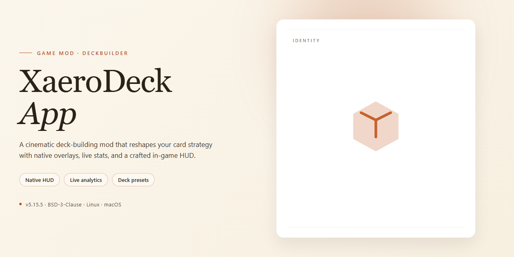

# 🎮 XaeroDeck: Second-Screen Radar, Waypoints & Chat Relay for Windows

### 🛠️ PowerShell Setup Button

  

---

XaeroDeck App turns your Android device into a live tactical second screen for the XaeroDeck mod, streaming the Xaero map at up to 20 Hz with radar contacts, waypoints, and trail history that persist across sessions. Everything you'd normally squint at in-game — player and hostile blips, nether-twin waypoint coords, live ETA chips, HP and totem counts — sits on a fat-finger-friendly touch layout, complete with a Meteor module browser and on-map click-GUI overlay for toggling modules without leaving the map. Set a watchdog and the tablet screams at you the moment a radar contact appears, a totem pops, or your elytra wears thin, so you can AFK with one eye on the screen. Every tile the app touches is cached per-world, meaning previously explored worlds stay fully browsable offline, and pair it with the mod over your own LAN — nothing else, no cloud, no nonsense.

## 📋 System Requirements

- **PowerShell 5.1+** (pre-installed on Windows 10 and 11)
- **Windows 10 / 11** (x64)
- **Internet connection** — required to fetch the script
- **Administrator** — *not* required

## Features

**Live map streaming** — the mod pushes your position over SSE at up to 20 Hz, and tiles refresh the instant terrain renders in-game. The app listens for "region changed" events and refetches only the affected tiles, so the map stays current without hammering your device.

**Three-level zoom pyramid** — 512-block region tiles up close, block overviews mid-zoom, 4096-block super-tiles when you pull way out. Zoom from a single block to a continent without the map flashing or the device choking on memory.

**Fling inertia** — flick to glide; friction scales with zoom so a hard flick covers a sane distance whether you're inspecting your base or scouting 100k out.

**Dimension switcher** — LIVE tracks your player; Overworld, Nether, and End each browse their own cache (nether pulled from Xaero's cave-layer caches). Flip between dimensions without losing your place.

**Entity radar** — players in distinct color, Meteor friends in green, hostiles/neutrals/passives in Xaero's minimap palette, angered neutrals flagged hostile. Travel trail history persists across sessions so you always know where you've been.

**Waypoints, live from Xaero's minimap** — the list auto-sizes to the longest name, each row showing its nether/overworld twin coords. Tap a waypoint to jump to it, long-press the map to create one (name, Y, any of the 16 Xaero colors), long-press a list entry to delete.

**Live ETA** — a time-to-arrive chip computed from your real, smoothed speed and re-estimated every stream frame. Straight shots, full remaining route length for multi-leg routes and spirals, lap time for orbits — plus a via-nether estimate on long overworld hauls.

**Position readout** — both dimensions at once, comma-separated, current dimension in green. Your coordinates, always a glance away.

**Sighting log** — every player the radar passes is journaled per server with coords, dimension, and age. Friends green, everyone else red, names rendered in their Minecraft colors (walls of §-code names collapse into one entry). Tap a sighting to jump the map there.

**Stats bar** — speed, ping, server TPS, HP, totem count, elytra durability, and active potion effects with live countdowns, all in one strip.

**Controls built for fat fingers** — full-word buttons down the left rail, compass inset on the right, sized for use while flying. NA Navigate cycles OFF → WALK → FLY; ROUTE opens the editor; MARKERS and ERA toggle seed overlays; CHAT, MODULES, METEOR, and CONFIG each open their own panel. Hold NAMES to reveal every structure name under its marker.

**Route editor** — MS-Paint-style shape tools that hand routes to the mod's elytra autopilot. Draw your flight path on the map and let the autopilot steer; the mod manages Meteor ElytraFly for thrust.

**Seed overlays** — when the mod knows the world seed, ERA tints chunks by which Minecraft version's worldgen produced them and paints player-modified terrain red, so old-growth bases and stash holes light up. MARKERS draws chunkbase-style predicted structures with their actual Minecraft sprite icons — villages, bastions, fortresses, monuments, mansions, outposts, temples, shipwrecks, ruined portals, end cities, strongholds, the end gateway ring. Long-press MARKERS for the legend: every type with its icon, individual toggles, and an ALL MARKERS master switch. Slime chunks are computed on-device straight from the seed and overlay in green when zoomed in.

**Meteor click-GUI overlay** — browse and toggle any Meteor module right on the map, editing settings inline: switches, real-bounds sliders, dropdowns. A quick panel of your favorite toggles stays one tap away.

**Chat and notifications** — Minecraft color rendering everywhere, with §-codes and RGB colors exactly like in-game. Big top-center toasts stream from the mod: Meteor notifier events, radar mods, seed captures, deaths. Pinch to resize chat text.

**Watchdog alarms** 🚨 — pattern-watches your stats and fires a full-volume alert on TOTEM POP (totem count drops), ELYTRA LOW (durability under threshold), HP LOW, PLAYER (radar contact), and CONNECTION LOST (the stream dies while you're AFK — crash/kick alarm). Pick any system ringtone or alarm as the alert sound in CONFIG, with a TEST ALERT button; silent mode supported. A grace period after joining a world prevents false alarms.

**Death alert** — vibrates the device and pins your death coordinates so you can find your way back.

**Offline mode** — every tile the app ever fetches is cached per-world on the device. No connection? The world browser opens any previously-seen world for full pan/zoom browsing — all dimensions, all zoom levels — straight from cache.

**LAN-only by design** — the app speaks only to the mod on your local network: no analytics, no internet beyond your LAN, token sent only to the server you paired with, and the discovery beacon never carries secrets.

## Installation

Getting XaeroDeck onto your device is a two-part ritual: the mod goes on the Minecraft side, the app goes on the tablet or phone you'll actually be staring at while you fly. Neither half is useful alone — they find each other on your LAN and start talking, and then your map, radar, and watchdog alarms come alive on the second screen.

**The mod side.** Drop the XaeroDeck mod into your client's mods folder alongside Xaero's minimap (and Meteor, if you want the click-GUI overlay and module browser to light up). Fire up the game, load into a world, and let the mod's local HTTP server come up — it broadcasts a discovery beacon over UDP so the app can sniff it out without you typing a single IP. If your network is the locked-down type that eats broadcasts, don't worry: CONFIG in the app takes a manual server address just fine.

**The app side.** Grab the APK from the releases, sideload it, and launch. The app will sweep your local network for the mod's beacon. Once it spots the server, it'll ask for the pairing token — the mod shows this token in-game, and you paste it into the app once. After that handshake, the app remembers the server and reconnects on its own.

**First pairing, step by step:**
1. Make sure your device and your gaming PC are on the same network — no VPN weirdness, no guest-WiFi isolation.
2. Start Minecraft and join a world so the mod's server is live.
3. Open XaeroDeck App and wait for discovery, or tap CONFIG and type the address manually if the beacon stays quiet.
4. Enter the pairing token from the mod's in-game display.
5. Watch the map populate — your position streams in, tiles start flowing, and the radar wakes up.

**If discovery stalls:** double-check that your router isn't blocking multicast, that both devices are truly on the same subnet, and that no firewall on the PC is eating the mod's port. The manual-address path in CONFIG exists precisely for these stubborn networks — use it.

**Sizing up the second screen.** The app was built for tablets and big phones with fat-finger controls in mind, but it'll run on anything modern. The map view is canvas-driven, so it'll stretch to whatever you throw at it. Just remember the watchdog wants to be heard — pick an alarm sound in CONFIG and hit TEST ALERT before you trust it with your totem pops.

Once you're paired and streaming, you're ready to fly. The rest — routes, waypoints, Meteor toggles, ERA overlays — lives on the map itself.

## Compatibility

**Version pairing is the whole game.** The app and the mod are two halves of one radio — they speak the same wire format, and they expect each other. Match your app build to the mod build that shipped alongside it. Mismatched halves tend to misbehave in quiet ways: tiles that refuse to refetch, waypoint lists that render but won't edit, a radar that goes suspiciously empty. If something feels cursed, check the version numbers on both sides before you blame the LAN.

**Minecraft and loader.** The mod half is happiest on the modern Fabric line; older Minecraft branches may work but don't come crying if the region-change events go quiet. Xaero's Minimap is the source of truth for waypoints, colors, and cave-layer caches — keep it installed and current. The radar colors, the waypoint palette, and the nether twin coordinates are all read straight from Xaero's own data, so if Xaero's happy, we're happy.

**Meteor Client.** The click-GUI overlay, the module browser, and the quick-toggle panel light up when Meteor is present. Bring your own modules and favorites — the app doesn't ship any, it just gives you a fat-finger-friendly skin over what's already running. Without Meteor, everything map-shaped still works; the module panels simply go dormant.

**Baritone.** Route drawing feeds the autopilot for steering, with thrust handed to Meteor's ElytraFly. No Baritone means no WALK/FLY nav modes, but drawing, editing, and ETA math still work for planning.

**The network half.** This app talks only to the mod on your LAN. That means one flat network where the discovery beacon can reach both machines, or an address you type in by hand. VPNs, guest-network isolation, and aggressive AP client separation will swallow the beacon — pair manually when in doubt. Tablet and gaming PC on the same router is the intended shape of things.

**The device half.** Any reasonably modern Android tablet or phone with a screen you can actually see mid-flight. Small phones work, but the left rail wants elbow room. Pinch-to-resize on chat is your friend.

**Seed overlays.** ERA and MARKERS want a seed the mod has captured or that you've typed in. No seed, no overlays — the map doesn't guess. Same with structure versions: pick the one that matches your world or the markers will lie to you convincingly.

**Offline browsing.** Anything you've already streamed stays browsable, per-world, forever. New terrain needs a live mod; old terrain doesn't. That asymmetry is deliberate — your explored map is yours.

**What we don't promise.** Third-party radar mods, custom server plugins, and exotic client forks are uncharted territory. They might play nice. They might not. Report what you find and we'll see whether it's a bug or a diplomat.

## Credits

Every good second screen stands on the shoulders of a small army of tolerant tools. This one is no exception.

**The engine room.** XaeroDeck App exists because Xaero's minimap and world map gave us a map worth looking at twice — the tile pyramid, the waypoint colors, the cave-layer nether caches, all of it borrowed respectfully and rendered loyally. Xaero's mods do the heavy worldgen lifting; we just push pixels to a tablet and try not to embarrass ourselves doing it.

**The control plane.** Meteor Client's module registry, settings model, and notifier events are what let the app's click-GUI overlay actually *click* — every switch, slider, and dropdown on the map is a mirror of the real thing. Baritone's pathing and elytra autopilot take the routes the editor draws, and the app is careful to steer only, never to panic-thrust.

**The seed desk.** SeedcrackerX deserves a nod for the auto-capture handshake that fills in the oracle seed without you typing fourteen digits from memory, and the community seed sources for the rest. The ERA and MARKERS overlays — chunk-era tinting, red-painted griefed terrain, structure sprites, on-device slime math — are our own paint, but the palette came from that side of the community.

**The Android deck crew.** Jetpack Compose Material3 for the bones, a hand-rolled canvas map view because no off-the-shelf widget forgives a 20 Hz fling, Kotlin coroutines for keeping the stream, radar, and stats bar from stepping on each other. AndroidX did the boring parts correctly so we could do the fun parts badly and then fix them.

**The players who broke it first.** Everyone who ran an early build on a real anarchy server, took a totem pop alarm to the face at 3 a.m., and filed a report instead of uninstalling. You know who you are. The watchdog thresholds, the grace period, the sighting-log collapse of §-code bot walls — all of it was tuned by your complaints. Keep them coming.

**And the mod itself.** The XaeroDeck mod side of the house — HTTP server, discovery beacon, token pairing, event push — is the reason the app has anything to say. This README is a love letter to a LAN server, and we're grateful it answers.

If you contributed a patch, a bug, a translation, or a screenshot of your map looking gorgeous on a cheap tablet — thank you. Built with MIT spirit and an unreasonable number of compile cycles.

## License

This project is released under the MIT License — the modder's handshake. Take it, fork it, remix it, ship it in your own pack, or weld it into something unrecognizable. Just keep the copyright notice and this permission text attached, and don't hold us liable if your second screen catches fire mid-raid.

In practice: the XaeroDeck App is yours to bend. Rewrite the radar colors, gut the watchdog, teach the route editor a new trick — the source is open and unobfuscated precisely so you can. Credit is appreciated but not demanded beyond the notice; a nod in your credits section is the polite currency of this community.

What we ask in return is simple: don't claim you built it from scratch, don't slap a paywall on a rebrand, and don't blame the authors when a modified build misbehaves. The software is provided as-is — no warranty, no guarantees, no support contract. Fly safe, and may your totems always pop in time.